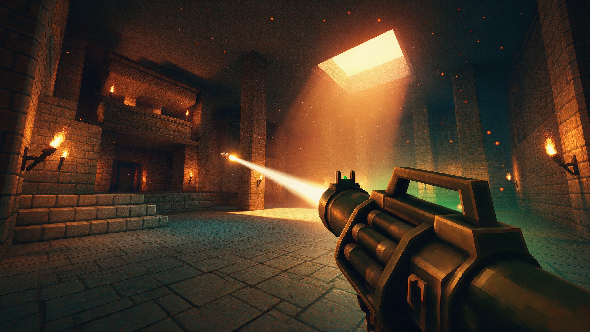

# Old-School 3D FPS Arena

A tiny old-school first-person shooter starter: fast, tuned movement in a brick arena, ready for your weapons and enemies.

It is deliberately small. The movement core is done, so you can spend your time on the fun parts.

## What's inside

- Tuned first-person controller with sprint, air control, coyote time, jump buffering and heavier fall gravity.
- Captured mouse look with editable sensitivity and pitch limits.
- A 40 x 40 m arena built at runtime from simple boxes: walls, pillars, obstacles, a low platform and climbable steps.
- A public `add_external_velocity()` hook for knockback, explosions, jump pads and conveyors.
- Tiny 64 x 64 pixel textures with procedural fallbacks, and the GL Compatibility renderer, so it runs on weak hardware.

## Get started

1. [Download the ZIP](https://github.com/SummerEngine/template-3d-fps-old-school/archive/refs/heads/bror-templates.zip) or clone the repo:
   `git clone https://github.com/SummerEngine/template-3d-fps-old-school.git`
2. Open the folder in [Summer Engine](https://www.summerengine.com/download).
3. Press Play.

Summer's AI agent can extend it for you. Try asking:

- "Add a rocket launcher with splash damage that uses the knockback hook for rocket jumps."
- "Add floating demon enemies that chase the player, plus a health and ammo HUD."
- "Add jump pads and a wave-based survival objective."

## Controls

| Action | Input |
|---|---|
| Move | W, A, S, D |
| Look | Mouse |
| Jump | Space |
| Sprint | Shift |
| Release mouse | Esc |
| Recapture mouse | Click in the game window |

## Project layout

- `main.tscn`: entry scene.
- `scripts/player_controller.gd`: movement and mouse look.
- `scripts/arena.gd`: builds the arena, obstacles and steps at runtime.
- `textures/`: floor and brick textures.

## License

MIT. See [LICENSE](LICENSE).
